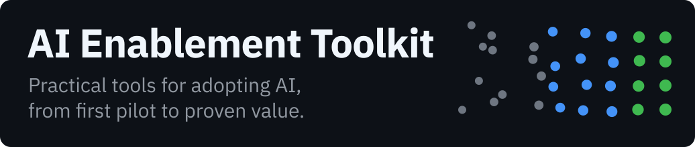

<p>
  
</p>

**Reusable material for bringing AI tools into a team: finding out why people stop using them, building the literacy to use them well, and reporting what changed.**

> [!NOTE]
> **Work in progress.** 9 of 21 items are available today. The other 12 are listed below with their status, so you can see where the toolkit is going. Each available item stands on its own.

## At a glance

| | |
|---|---|
| **Goal** | Help organizations adopt AI tools in ways that last: choose the right uses, prepare people, govern what AI may do, and confirm the value. |
| **What was done** | A growing set of practical guides and templates for adoption reviews, AI literacy, governance and assessment, each usable on its own. |
| **Governance** | Every decision has a named owner, AI actions are authorized before they happen, people interviewed stay anonymous, and limits are stated up front. |
| **Measurement** | Adoption reported as n of N, value measured against a baseline, review skill tracked through drills; so far the evidence is one trial. |

## What's in the toolkit

Status: **available** · **next** (the next batch being built) · **planned**. Nothing marked next or planned exists yet.

### Adoption

| Item | What it does | Status |
|---|---|---|
| [**Adoption review kit**](adoption-kit/) | Interview, four-way diagnosis (tool, workflow, training, habit), feedback page and usage tracker, with a 20-rule check script | **available** |
| [**Structured reporting**](adoption-kit/REPORTING.md) | Priority block on feedback pages, status report and one-page leadership brief, written by hand | **available** |
| Report generator | Builds the status report and brief from the CSV files, with the same tested checks | next |
| Usage-log guide | How to read a tool's own usage report, so tracker figures come from logs and not memory | next |
| Spanish version of the kit | Interview guide and consent script first | planned |
| Second trial | Interviews with other people, which lifts *n* above 1 | planned |

### Literacy

| Item | What it does | Status |
|---|---|---|
| [**AI literacy deck** (Spanish - Costa Rica)](literacy/deck/) | 19 slides for non-technical teams: governance, blind spots, security, tools, prompting, glossary · [open the deck →](https://luispsalas.github.io/ai-enablement-toolkit/literacy/deck/alfabetizacion-ia-deck.html) | **available** |
| [**Reviewing AI output**](literacy/reviewing-ai-output.md) | Where AI errors hide in fluent output, a short routine for checking what matters, and a drill to build the skill | **available** |
| [**English–Spanish glossary**](literacy/glossary.md) | 38 governance, literacy and adoption terms in five groups, with both usages recorded where they differ; the deck and the toolkit's pages share it | **available** |
| Prompt quick-reference card | One page for any AI chat tool, for non-technical users: how to ask, how to check | planned |
| Training pre/post check | Did the session change what people do, not only what they know? Feeds the usage tracker | planned |

### Governance one-pagers

| Item | What it does | Status |
|---|---|---|
| Acceptable-use one-pager | What data may go into which AI tool, and when to ask first | planned |
| AI tool evaluation scorecard | Does the tool work in *this* workflow? Broken versus confusing, before buying | planned |
| AI oversight levels | How much human review an AI task needs, from approving every case to reading the log, and what decides it: reversibility, reach, detectability and the data involved | next |
| [**AI operating model one-pager**](governance/operating-model.md) | Who decides what: roles and decision rights for AI tools, the cycle from idea to pilot to rollout, and what each review checks | **available** |
| [**AI agent specification template**](governance/agent-spec-template.md) | One page a delivery team can build from: goal and owner, data it must never see, tools and permissions, what goes to a person, failure paths and success metrics, with an example | **available** |

### Assessment

| Item | What it does | Status |
|---|---|---|
| [**Business AI needs assessment**](assessment/needs-assessment.md) | Where AI could help across the organization: a questionnaire on goals, work, data, skills and risk, or a wireframe of a hypothetical use case when goals are unclear, ending in ideas for the intake canvas and a baseline to measure value against | **available** |
| [**Use-case intake and prioritization canvas**](assessment/intake-canvas.md) | For each idea: can it be done, and should it be (value, feasibility, risk), with stop criteria to disqualify early | **available** |

### Rollout templates

| Item | What it does | Status |
|---|---|---|
| Walkthrough script and quick reference | A short guided session on one tool and task, and the card for that tool that people keep afterwards | next |
| Office-hours and release-briefing templates | A standing session for questions, and a short note for each later change to a tool already in use | planned |
| Change-communication pack | For the first rollout of a new tool: announcement, FAQ and "what changes for you" | planned |

## What this does not do (read first)

- **The adoption kit is a method, tried once.** One trial, n = 1, and the person interviewed set up the tool being studied. It produced 2 diagnosis rows, 2 tracker rows and 1 feedback page ([the trial](examples/trial-n1/)), which shows the method runs end to end, not how common any finding is.
- **It does not measure usage automatically.** The tracker records what people report or what a usage log shows, and every row says which.
- **The deck is written for a Costa Rican audience.** Its references were checked on each publisher's own page in October 2026. A general English version is in progress.
- **No research grounding yet.** Nothing here cites adoption studies; if it does later, each source will be checked against the primary first.

## Why it matters

Teams are given AI tools faster than they are shown how to use them. When usage stays low, the usual reactions are to blame the tool or to run another training session, and both can be wrong. Low usage has at least four causes (the tool, the workflow, training, habit), and each needs a different person to fix it. The adoption kit decides which is which and checks that the fix reached the people who were stuck; the literacy material covers the training cause before it happens. Details: [adoption kit](adoption-kit/), [deck](literacy/deck/). The working principles behind all of it are in [PRINCIPLES.md](PRINCIPLES.md).

## Quick start

```bash
python3 tools/test_check_lists.py
```

This proves the checker works: each of its 20 rules must catch a planted error, and miss it when switched off. It should end with `ALL PASSED`. Then check your own files before sending anything on:

```bash
python3 tools/check_lists.py adoption-kit/diagnosis-sheet.csv adoption-kit/usage-tracker.csv
```

Python 3, standard library only. The documents are plain Markdown and CSV, so they work in any editor or spreadsheet.

## Repository map

```
PRINCIPLES.md   the working principles behind the toolkit
adoption-kit/   interview guide, diagnosis sheet, feedback template, usage tracker,
                REPORTING.md, leadership brief template, and the two CSV templates
literacy/       the guide to reviewing AI output and the English–Spanish glossary; deck/ holds the AI literacy deck (Spanish - Costa Rica, one HTML file)
governance/     the AI operating model one-pager and the AI agent specification template
assessment/     the business AI needs assessment and the use-case intake and prioritization canvas
tools/          check_lists.py (20 rules) and its tests
examples/       trial-n1/: the first trial (n = 1, real, anonymized)
assets/         the banner
```

## How it was built

Written in plain Markdown and CSV, with a short Python check script. The adoption kit was **AI-assisted**: an AI coding agent drafted the guide, sheet, templates and script from a brief I wrote, and I reviewed and edited them. Its trial interview was also run by an AI agent, in a chat, following the guide as written; I answered as the interviewee.

## Related concepts

From the [Applied AI Concepts](https://luispsalas.github.io/applied-ai-concepts/) wiki: [AI Literacy](https://luispsalas.github.io/applied-ai-concepts/concepts/ai-literacy.html) · [Shadow AI](https://luispsalas.github.io/applied-ai-concepts/concepts/shadow-ai.html) · [Automation Bias](https://luispsalas.github.io/applied-ai-concepts/concepts/automation-bias.html) · [Human-in-the-Loop](https://luispsalas.github.io/applied-ai-concepts/concepts/human-in-the-loop.html) · [Continuous Feedback & Improvement](https://luispsalas.github.io/applied-ai-concepts/concepts/continuous-feedback-improvement.html)

## License

Code (`tools/`): [MIT](LICENSE). Documents, templates, examples and the deck: [CC BY 4.0](LICENSE-docs). © 2026 Luis P. Salas.
